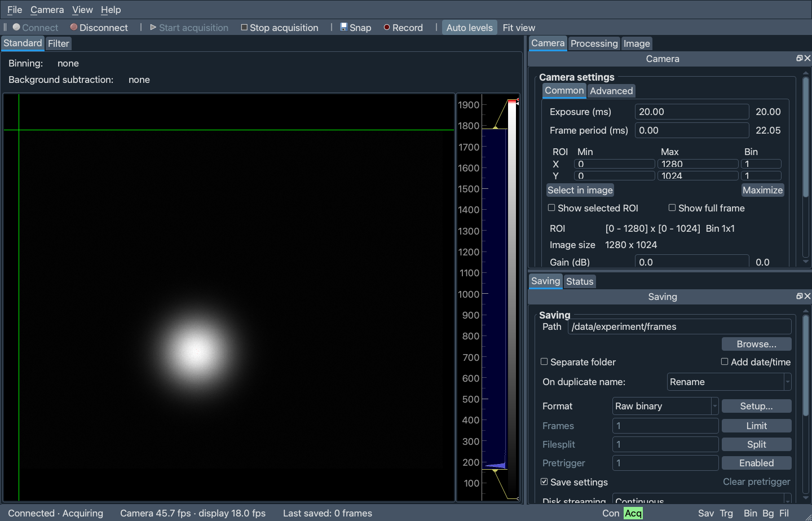

PyLabLib cam-control: Software for universal camera control and frames acquisition
==================================================================================

PyLabLib cam-control aims to provide a convenient interface for controlling cameras and acquiring their data in a unified way.

This is a fork of `AlexShkarin/pylablib-cam-control <https://github.com/AlexShkarin/pylablib-cam-control>`__ 2.2.1, restructured into an installable ``camcontrol`` Python package, with a reworked interface, a vendor-software-free Thorlabs camera backend and hardware-free test cameras.

Features
~~~~~~~~~~~~~~~~~~

- Communication with a variety of cameras: Andor, Hamamatsu, Thorlabs, IDS, PCO, Photometrics, Princeton Instruments, Basler, PhotonFocus with IMAQ, BitFlow, and Silicon Software frame grabbers.
- Thorlabs Zelux and Kiralux/Quantalux CS-series cameras directly over USB, without ThorCam or any vendor DLL (``ThorlabsTSIDirect``).
- Operating at high frame (>50 kFPS) and data (>300 Mb/s) rates.
- On-line data processing and analysis: `binning <https://pylablib-cam-control.readthedocs.io/en/latest/pipeline.html#pipeline-prebinning>`__, `background subtraction <https://pylablib-cam-control.readthedocs.io/en/latest/pipeline.html#pipeline-background-subtraction>`__, simple built-in `image filters <https://pylablib-cam-control.readthedocs.io/en/latest/advanced.html#advanced-filter>`__ (Gaussian blur, Fourier filtering), `playback slowdown <https://pylablib-cam-control.readthedocs.io/en/latest/advanced.html#advanced-slowdown>`__ for fast process analysis.
- Customization using `user-defined filters <https://pylablib-cam-control.readthedocs.io/en/latest/expanding.html#expanding-filter>`__ (simple Python code operating on numpy arrays) or control from other software via a `TCP/IP interface <https://pylablib-cam-control.readthedocs.io/en/latest/expanding.html#expanding-server>`__.
- Flexible data acquisition: `pre-trigger buffering <https://pylablib-cam-control.readthedocs.io/en/latest/pipeline.html#pipeline-saving-pretrigger>`__, initiating acquisition on `timer, specific image property <https://pylablib-cam-control.readthedocs.io/en/latest/advanced.html#advanced-save-trigger>`__, or `external software signals <https://pylablib-cam-control.readthedocs.io/en/latest/expanding.html#expanding-server>`__.
- Dockable, rearrangeable panels with a remembered layout, toolbar, keyboard shortcuts, image zoom/pan and pixel readout; camera errors (e.g. an unplugged camera) don't close the application.

Installation
~~~~~~~~~~~~~~~~~~

Requires Python 3.12 or newer. From a checkout of this repository::

    python -m venv .venv
    .venv/bin/pip install -e .                  # on Windows: .venv\Scripts\pip install -e .
    .venv/bin/pip install -e ".[thorlabs-tsi]"  # optional: direct-USB Thorlabs cameras (pyusb + libusb)
    .venv/bin/pip install -e ".[dev]"           # optional: ruff, pytest

Camera backends other than the simulated ones need their manufacturer's drivers/SDK; see the `software requirements <https://pylablib-cam-control.readthedocs.io/en/latest/overview.html#overview-software-requirements>`__.

Running
~~~~~~~~~~~~~~~~~~

The settings file (``settings.cfg``), the stored GUI state (``defaults.cfg``) and the logs (``logerr.txt``, ``logout.txt``) are resolved relative to the **current working directory**, so run the commands from the folder with your setup's configuration::

    cam-control-detect                     # find connected cameras, write them to settings.cfg
    cam-control                            # the application (same as: python -m camcontrol)
    cam-control --camera thorlabs_tsi_direct_0
    cam-control-console --config-file other.cfg   # no splash screen, errors on the console

To try it without any camera, put a simulated or an emulated Thorlabs camera into ``settings.cfg``::

    cameras/sim1/kind	simulated
    cameras/sim1/params/size	(1280, 1024)
    cameras/tsi_mock/kind	ThorlabsTSIMock
    cameras/tsi_mock/params/family	cs
    cameras/tsi_mock/params/color	True

The emulated Thorlabs camera speaks the camera's own USB protocol, so the whole direct-USB backend runs on it, and it can inject faults (dropped data, USB stalls, unplugging). See `docs/thorlabs.rst <docs/thorlabs.rst>`__.

Development
~~~~~~~~~~~~~~~~~~

::

    ruff check . && ruff format --check . && pytest

The tests need no hardware (they use the simulated and emulated cameras, with Qt offscreen) and run on Linux, macOS and Windows with Python 3.12-3.14 in CI.

Documentation
~~~~~~~~~~~~~~~~~~

Upstream documentation is available at https://pylablib-cam-control.readthedocs.io/en/latest/; the ``docs`` folder holds the updated version for this fork.

Related projects
~~~~~~~~~~~~~~~~~~

Cam-control is built using `pylablib <https://github.com/AlexShkarin/pyLabLib>`__, a more generic library for experiment automation and data acquisition, which included lots of additional `devices <https://pylablib.readthedocs.io/en/latest/devices/devices_root.html>`__ besides cameras.
